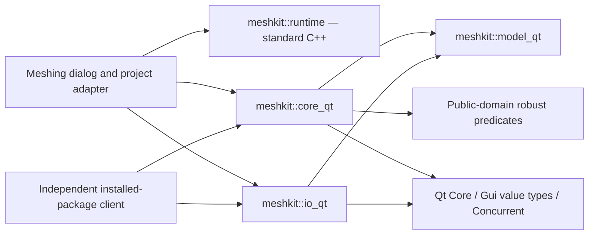
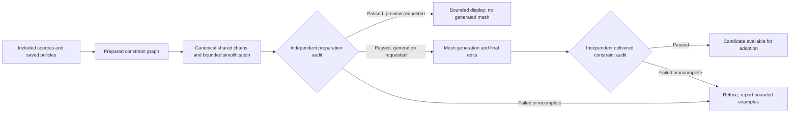
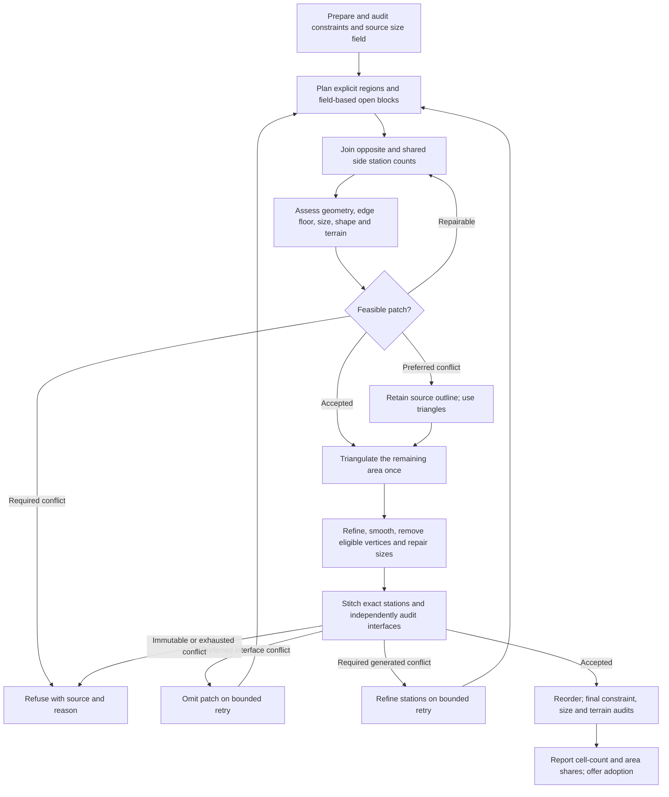
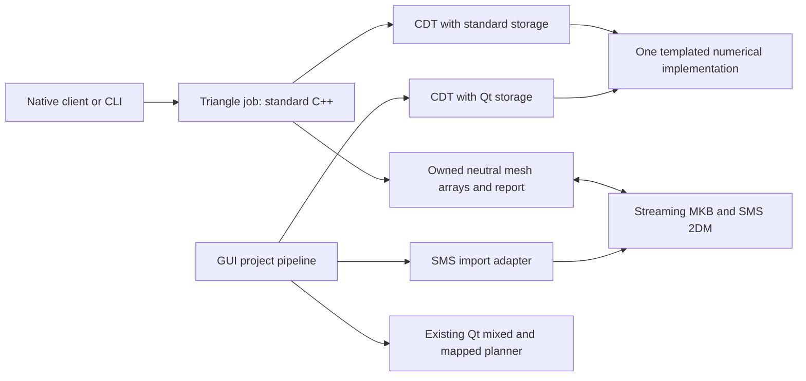

# Meshing implementation progress

Date: 2026-10-29. Based on the [review and implementation plan](2026-10-29-meshing-review-and-library-extraction-plan.md). This records the implemented foundation and its remaining limits; the full numerical-policy redesign is not complete.

Latest checkpoint: [native jobs, streaming I/O and shared constraint fixes](#native-jobs-streaming-io-and-shared-constraint-fixes). Earlier sections record the successive deliveries and their then-current limits.

## Implemented

- A persistent **Run log** tab in the meshing dialog, including severity/search filtering, details, copy, text/JSONL export, follow-latest, retained completion/cancellation/failure reports, and exception highlighting.
- Per-job structured events with distinct working-vertex, output-vertex, triangle, quad, insertion and removal counts; monotonic overall progress; explicit second-pass labels; throttled GUI updates; bounded producer queue (2,048 rows by default) and visible history (10,000 rows). Overflow counts are visible and exported. No global Qt logging handler is installed.
- Live triangle counts maintained at topology edits, avoiding scans at every progress update. Tests compare the maintained count against scanned liveness after refinement, boundary splitting and coarsening.
- Resource-limited results reported as incomplete and refused by GUI adoption, preserving the prior mesh. Successful generation retains the dialog for review; closing it still returns the accepted result expected by the application.
- Exception membership stored in one bit per cell, with exact total counts and at most 10,000 selected examples. This avoids millions of hash-table/selection objects.
- A standalone [MeshKit CMake project](../../libraries/meshkit/README.md), linked by the GUI and tests. It contains the existing constrained mesher, size field, patch/strip/quad helpers, mesh statistics/reordering, interpolation, and native INP/2DM plus SMS readers/writers. Core algorithm tests now live with the library. Installed targets work in a separate downstream client.
- A global triangles-only gate covering generated quad regions, conduit strips and terrain strips. It preserves region boundaries/tags/local sizes and explicitly rejects contradictory prebuilt quad patches. Default standalone behavior remains unchanged.
- A [file provenance inventory](../../libraries/meshkit/PROVENANCE.md) covering 51 tracked predecessors, preserving the GPL and public-domain predicate notices. No permissive relicensing has been performed.



## Extraction boundary

The geometry and codec targets retain their current Qt value/container API, named `_qt` deliberately. They build without OpenSWMM, its engine, Widgets or GDAL. Only the event runtime is currently Qt-free. Terrain/GIS providers, boundary conditioning, GUI worker orchestration, project adoption/undo and feature export remain application adapters. Shared infiltration metadata and some serialization helpers remain in `model_qt`.

Moving these implementations first makes their tests and downstream linkage independently reproducible. The planned neutral array API, Qt adapter, standalone orchestration and streaming codecs are still needed before the final independent-release gate. Existing codec validation/precision limitations remain. A standalone legacy caller must check `stats().refineCapped`, not only `MeshResult::ok`.

## Validation evidence

Baseline before implementation: CDT 22 passed; generator 20 passed. Current checks:

- Application and selected test targets build successfully. The local macOS deployment step reports missing optional SQL driver dependencies, then excludes those unused drivers and finishes successfully.
- [Standalone CTest](../../tests/output/meshing_library_2026-10-29/standalone-test.log): 4/4 suites passed, including the CDT/generator suites, event stress and mesher/codec roundtrip.
- [GUI-linked regressions](../../tests/output/meshing_library_2026-10-29/regression-tests.log): 11/11 suites passed, covering CDT, generator, log model, native/SMS codecs, constraint preparation/trimming, size field, reorder and cell parameters.
- [Full terrain worker suite](../../tests/output/meshing_library_2026-10-29/pipeline-full.txt): 75 passed, no failures; 3 opt-in large/project benchmarks skipped. [Targeted outcome/adoption run](../../tests/output/meshing_library_2026-10-29/pipeline.txt): 25 passed, including resource-limit refusal and accepted closure after successful adoption.
- [Infiltration integration](../../tests/output/meshing_library_2026-10-29/infiltration-tests.log): passed.
- [Runtime-only build](../../tests/output/meshing_library_2026-10-29/runtime-only-test.log): passed with Qt explicitly disabled.
- Installed-package consumer configures, links and generates/serializes a mesh with only the installed MeshKit package and Qt in its dependency paths.
- The 600-hole/24-breakline reference fixture retains 19,249 cells and its pre-extraction hash `665bcd25f66fd6bd`.
- Modified tracked source/document files pass whitespace checks. Existing unrelated example-file whitespace issues were left untouched.

The log widget screenshot uses synthetic demonstration events, not the large mesh benchmark: [Run log preview](../../tests/output/meshing_library_2026-10-29/run-log.png).

| Kernel workload | Input vertices | Live triangular cells | Elapsed, including checks | Peak process RSS |
| --- | ---: | ---: | ---: | ---: |
| Uniform grid, four constrained sides | 50,451 | 100,000 | 0.073 s | 21.9 MB |
| Six-million-cell probe | 3,003,501 | 6,000,000 | 19.678 s | 413.5 MB |
| Six-million-vertex probe | 6,000,000 | 11,990,002 | 31.540 s | 766.1 MB |

Release build; Qt 6.9.3; Apple arm64/macOS 27.0.1; timings from this local run while other compilation work was active. MB are decimal. These probes verify the expected live count, positive triangle areas and total rectangular area. They are **kernel capacity measurements**, not end-to-end DEM, mixed-cell, file I/O, GUI/renderer, cancellation or hydraulic performance certification. Six million vertices and six million cells are distinct workloads.

Reproduce with `MESHKIT_BUILD_BENCHMARKS=ON`, then `meshkit_scale_probe 2001 1501` and `meshkit_scale_probe 3000 2000`. Raw reports: [six million cells](../../tests/output/meshing_library_2026-10-29/scale-6m-cells.json), [six million vertices](../../tests/output/meshing_library_2026-10-29/scale-6m-vertices.json). The six-million-event stress test separately verifies bounded logging; it does not stand in for a mesh benchmark.

## Synthetic terrain worker at scale

The complete headless GUI worker was also exercised on a 24,039,409-sample planar DEM, using a 16 MiB terrain cache and the actual meshing/refinement, optional open-block second pass, elevations, reordering and final terrain verification stages.

| Cell mode | Delivered cells | Quads | Elapsed | Peak process RSS |
| --- | ---: | ---: | ---: | ---: |
| Triangles only | 6,499,882 | 0 | 16.924 s | 2.450 GB |
| Automatic mixed | 3,345,190 | 2,450,508 | 27.076 s | 2.962 GB |

Both runs passed, with zero unresolved/unknown terrain cells and no refinement cap. The triangular run exceeds six million delivered cells. The mixed run uses the same resolution recipe but yields fewer cells; it is not evidence of six million mixed cells. These measurements include worker-owned mesh/terrain data, but not GUI rendering, an existing GUI mesh, undo history or final mesh-file publication. They do not certify difficult terrain, hydraulic equivalence or worst-case geometry.

The first mixed run completed correctly but failed the old benchmark's `cells > 0.85 × target` assertion: that target was calibrated for triangles. The benchmark now makes cell mode explicit (`SWMMVIS_TERRAIN_SCALE_QUADS=0`, or `2` for mixed) and applies that count assertion only to its calibrated triangular workload. The original failed assertion is retained in [the original mixed-run transcript](../../tests/output/meshing_library_2026-10-29/terrain-mixed-original-assertion.txt); production sizing was not changed to satisfy the benchmark.

Reproduce the triangular case with `SWMMVIS_TERRAIN_SCALE_CELLS=6000000`, `SWMMVIS_TERRAIN_SCALE_QUADS=0`, a writable `SWMMVIS_TERRAIN_PIPELINE_OUTPUT`, and the normal test GDAL/PROJ paths, then run `test_meshterrainpipeline largeTerrainPipelineBenchmark`. Evidence: [triangular run](../../tests/output/meshing_library_2026-10-29/terrain-6m-triangles.txt), [mixed run](../../tests/output/meshing_library_2026-10-29/terrain-mixed.txt), [machine-readable results](../../tests/output/meshing_library_2026-10-29/terrain-scale-results.json).

## Remaining work against the plan

| Area | Current state | Next deliverable |
| --- | --- | --- |
| Baseline/reporting | Core/log/adoption tests, kernel capacity and synthetic-plane worker measured; broader workload and rights review incomplete | Realistic terrain, holes, mixed-cell, I/O and GUI baselines with memory/cancellation evidence |
| Independent library | Build/install/downstream linkage implemented with transitional Qt types | Qt-free geometry/arrays, standalone request/report orchestration, terrain and streaming format adapters |
| Constraint simplification | Bounded collection pass, exact-coordinate joining and per-feature line overrides implemented in the second delivery | Canonical shared edges; source-level policy UI; preview; independent delivered-geometry audit |
| Sizes and transitions | Existing target calibration retained and reported | Versioned nominal-size metrics, feasibility checks, conservative footprint caps, independent audit and bounded local repair |
| Quad policy | Triangles-only inconsistency fixed; current mixed planner retained | Unified local precedence and mandatory/preferred regions; single-pass planning; bounded recombination |
| Terrain thinning/coarsening | Existing certified transactional removals retained | Optional target-size-weighted tolerance used consistently in refinement, removal and final checks; small-terrain exhaustive comparisons |
| Licensing/Python | Notices retained and provenance inventoried; no new licensing or bindings | Resolve rights and license; array-oriented Python API, ownership/GIL/cancellation and packaging tests |

No new simplification, size-floor, maximum-size, transition or terrain-weighting guarantee is claimed by this delivery. The 1.22 target calibration and current geometry-conditioning behavior remain in the legacy algorithm. Those numerical changes require the versioned policy and independent checks described in the plan.


## Second delivery — docked navigation and constraint policies

The Quality category list now lives in an embedded main-window dock. It starts on the left, can move to the right or float, and reserves enough width for its longest label plus scrollbar/frame at the current font. The layout test verifies 12/24-point labels, category selection while floating, redocking to the opposite side, and a genuinely embedded host. The [enlarged-font preview](../../tests/output/meshing_policies_2026-10-29/quality-docked.png) was visually checked.

A new collection-level `constraintsimplifier` in MeshKit implements per-feature preserve/simplify policies, XY and authored-Z limits, corner/fixed-point protection, absolute/relative ring-area bounds and optional minimum clearance. One immutable segment BVH supports shortcut/obstacle checks. Every shortcut checks its entire original span and monotone projection; original vertices lie within the replacement segment's convex tolerance capsule and the continuous span covers its projected interval, supplying a bidirectional XY bound. Swept-pocket tests protect holes and constraint components that could otherwise be excluded without an edge crossing. An output index checks new shortcuts against each other. Conflicts roll back; bounded work and cancellation retain original geometry. Stable source-vertex mappings and per-feature statistics are returned.

The dialog offers the existing recipe, preserve, and bounded modes. Existing recipes retain their behavior. New modes skip footprint generalization and proximity welding, preserve exact existing coordinates during joining, reject invalid protected holes, and refuse mixed inside/outside source paths rather than deleting outside intermediate vertices. Authored conduit unfolding/resampling is disabled in these modes; curved strips use plain constraints when their patch construction could approximate the path. Region/patch outlines and mandatory points remain protected. Auxiliary lines accept `mesh_simplify`, `mesh_xy_tol` and `mesh_z_tol` feature overrides. New geometry preparation bypasses the legacy boundary cache to prevent cross-policy cache reuse.

Standalone tests cover semantic pins, shared edges, nearby constraints, elevation detail, ring-area rollback, swept-pocket hole protection, cancellation, work budgets and source mappings. A six-million-vertex straight-source probe retained two endpoints in 1.221 seconds at 376,356,864 bytes process peak RSS. This is a simplifier capacity check, not evidence for complex six-million-edge arrangements or rendering. The generator additionally verifies that a narrow hole survives exact-coordinate joining.

This advances phase 3; canonical shared-edge editing, source-level policy UI beyond feature attributes, interactive before/after preview and a complete delivered-mesh policy audit remain. Revised sizing/transitions and resolution-weighted thinning remain later numerical phases. GPL terms and the transitional Qt API are unchanged.


Validation-build note: a concurrent application build was using `build/` with a different CMake executable. This task moved compilation to ignored `build-mesh-policies/` to avoid interleaved manifests. Its compiler-cache access is read-only, with temporary files in the task's writable cache directory. No other task's build process was stopped. The isolated application build completed successfully. The full integrated terrain suite passed 76 cases with no failures and three opt-in workloads skipped. The dock layout test passed all three cases, and all five standalone MeshKit suites plus the installed-package consumer passed. The new pipeline case exercises bounded/preserve modes, line-level overrides, hole retention and refusal of outside intermediate vertices. It caught and fixed an existing missing-closure bug for programmatic hole rings: the generator adapter now explicitly closes every hole constraint loop before adding the carve seed. Existing explicitly closed GIS rings are unaffected. See [pipeline results](../../tests/output/meshing_policies_2026-10-29/pipeline-full.txt) and [dock results](../../tests/output/meshing_policies_2026-10-29/dock-test.txt).

## Quality column correction and unrestricted transition input

The navigation dock's viewport could widen while the hidden tree header kept the text column at 100 pixels. The column now stretches to the viewport, with elision disabled and the existing label/font-aware minimum width retained. The regression checks the **actual text-column width** before any font changes, after resizing the dock and dialog, and at 12/24-point fonts. Docking/floating and page-selection checks remain. The prior viewport-only check missed this defect.

The transition input and shared settings validation now accept every finite rate at least 1.05, including values above 10. The default remains 2. The size-field's float storage and chamfer weights saturate at its existing finite sentinel so extreme accepted rates do not overflow the stored grid. This removes an authoring restriction; it does not add a guarantee on delivered adjacent-cell ratios.

The focused checks pass: 4 dock/settings cases and 14 size-field cases, including rates 25, 1000, 1e12 and the largest finite double, JSON settings roundtrip, invalid-value rejection, the effect of a larger transition rate, and finite bounded size-field samples. See [dock/settings results](../../tests/output/mesh-width-transition-2026-10-29/dock-tests.txt), [size-field results](../../tests/output/mesh-width-transition-2026-10-29/sizefield-tests.txt) and the [column preview](../../tests/output/mesh-width-transition-2026-10-29/quality-docked.png). Native macOS verification is complete: the focused dock/settings suite passes all 4 cases on Cocoa as well as offscreen. The full mesh-dialog suite passes all 6 cases, including typing 25 and verifying the actual text column at 900/1200-pixel dialog widths. The [native dialog capture](../../tests/output/mesh-width-transition-2026-10-29/quality-dialog-native.png), [wider capture](../../tests/output/mesh-width-transition-2026-10-29/quality-dialog-native-wide.png), [native dock results](../../tests/output/mesh-width-transition-2026-10-29/dock-native-tests.txt) and [integrated dialog results](../../tests/output/mesh-width-transition-2026-10-29/dialog-native-tests.txt) record this.


Local test-copy build note: application compilation completed, but a fresh macOS dependency deployment spent more than 17 minutes scanning unchanged Qt libraries. Only this task's packaging process was interrupted. The generated application link command was rerun against the freshly compiled objects; its linked-library list exactly matches the previously deployed app. The test copy reuses that package, with the new executable and the same relative library search path, and passes deep strict code-signature verification. It is at `build-mesh-policies/width-preview-ready/SWMMVis.app`, with the local-only display name **SWMMVis Mesh Preview** and a distinct bundle identity. The original GUI process was left running. This is a local test package, not a completed fresh-dependency deployment or release-package certification.

The integrated native dialog test was linked against those same application objects, replacing only the application entry point with its QtTest entry point and adding QtTest. It logs a missing standalone-harness OpenSWMM QML registration warning; the check covers the dialog and input behavior, not map rendering. Native widget grabs provide the layout evidence because the desktop controller could not reliably resolve multiple locally renamed app copies. No mesh generation or project save was requested by these UI checks.

## Source controls, shared constraints and independent audits — delivered increment

A newly requested regression reproduced the coarsening checkbox failure: a domain-covering triangle-only region was still included in the protected quad-region index. The checkbox reached the worker, but that protection left zero eligible attempts. `MeshGenerator` now protects only regions actually resolved as mapped quad patches. The checkbox-to-worker on/off regression passes with adaptive terrain both off and on, and the standalone generator suite passes, including pin/constraint/mapped-quad preservation. Evidence: `tests/output/constraint-review-2026-10-29/coarsening-before.txt` and `coarsening-after.txt`. Worker reporting now distinguishes skipped coarsening, no eligible free vertices and all attempted edits being rejected. The rebuilt local test copy at `build-mesh-policies/constraint-preview-ready/SWMMVis.app` includes this correction. In the checkbox-to-worker fixture, both terrain-off and terrain-on runs change from 287 cells with removal disabled to 283 with it enabled: 112 attempts and two removed vertices in each case. An enabled option can still legitimately remove nothing when all candidates are protected or fail size, shape or terrain checks.

The constraint increment now includes an exact shared-chain adapter and independent geometry audits. Exact shared original segments are grouped into chains, simplified once under the strictest owner limits, then stitched back with source-index mappings. Ring-area rejection rolls back the connected shared component. Different source sampling remains conservative. Work/memory exhaustion retains originals. Independent checks cover retained identities, XY/Z/area/corner bounds, shared consistency, original junctions, pockets/clearance, and delivered constraint coverage against actual incident cell edges (including domain/hole sides). The delivery checker is a constraint audit, not a general certificate that arbitrary cells never overlap.

The dialog now includes **Quality → Boundaries → Source-specific limits** for boundary sources, auxiliary line layers and model conduits. Optional source limits inherit the global values; feature attributes override source settings. Saved source policies use physical units, preserve their exact values across display-unit changes, retain unavailable source entries and refuse invalid saved limits until explicitly corrected. Conduits preserve by default. Multi-vertex conduit paths in the new modes remain ordinary constrained lines, since strip resampling could discard their authored vertices.

**Preview constraints…** runs preparation and its independent audit, then returns before terrain opening or mesh generation/adoption. The preview overlays prepared originals, proposals and sampled removal markers, with source counts/deviations and stale-input indication. Display data is capped at 50,000 vertices (including markers) and 500 features; the audit uses the full geometry. Selected polygon sources may already have been dissolved during preparation. The preview therefore compares prepared constraints, not original undissolved GIS features. Normal generation also retains this preview and must pass the delivered constraint audit after all geometry/elevation edits and reordering.



Validation for this increment:

- All five standalone library suites pass, including exact zero-deviation collinear cleanup, reversed shared rings/strict owner limits, conflicting shared Z, lost-junction/pocket protection, resource/cancellation behavior, tampered-audit rejection, actual cell-edge incidence and hole-side checks. A projected-coordinate generator case retains distinct vertices only 0.0001 units apart at coordinates near 1e9, with delivered coverage audited. This also caught and corrected an audit false rejection from counting a neighbouring edge that only touched a source segment endpoint.
- The full integrated terrain/pipeline suite passes **80 cases, zero failures, three optional workloads skipped**. It exercises source and feature override precedence, preparation-only early return, invalid metadata/missing boundary refusal, both audits, preview no-adoption/no-save behavior, source-policy persistence and checkbox-driven coarsening. Existing legacy generation, corridor adoption/ownership and saved-file protections still pass.
- Native macOS source/preview widget checks pass all five cases; the native full mesh-dialog suite passes all six. Normal/wide captures show the Quality column filling its dock and the source controls fitting the available width with vertical scrolling. The preview display is bounded without altering geometry. The standalone full-app test entry point still logs missing OpenSWMM QML registration; these tests certify dialog/worker behavior rather than map rendering.
- Straight-source preparation and independent audit at **6,000,000 vertices** complete in **4.422 s**, with **719.2 MB peak RSS** (simplification alone 2.567 s). A reversed shared source pair totalling **6,000,000 owner vertices** completes in **7.819 s**, **809.4 MB peak RSS** (simplification alone 4.188 s). These are simple capacity probes, not complex terrain/constraint guarantees. Temporary workspace limits are estimates and do not bound total process memory.

Evidence is under `tests/output/constraint-review-2026-10-29/`: `core-ctest.txt`, `pipeline-full.txt`, `pipeline-focused.txt`, `widget-tests-native.txt`, `dialog-native.txt`, `six-million-constraints.txt`, `six-million-shared.txt`, `constraint-preview-cocoa.png`, and `boundary-dialog-native.png` / `boundary-dialog-native-wide.png`.

The delivered-audit scale probe also passes at **6,000,000 cells** / 3,003,501 vertices. Converting the CDT to the current GUI DTO takes 0.286 s; the independent constraint audit takes **0.970 s**, scans every cell's incidence and checks the four required sides. Total triangulation, conversion and audit time is 16.860 s, at **1.047 GB peak RSS** with both geometry representations resident. See `six-million-cells-audit.json`. This is a uniform constrained grid capacity result, separate from the existing terrain-worker benchmarks and from GUI rendering. It is opt-in via `MESHKIT_AUDIT_DELIVERED=1 meshkit_scale_probe 2001 1501`.

The local application was linked from freshly compiled production objects. Its dependency list matches the preceding deployed preview; the test package reuses those deployed libraries and passes deep strict code-signature verification. This remains a local test package rather than a fresh-dependency release certification. It uses the distinct bundle identity `org.openswmm.swmmvis.constraint-preview` and was opened for testing. Existing user GUI sessions were left running. All new work stays in the existing checkout; no subagents or unrelated build processes were used.

Next in the original plan: independent delivered minimum/maximum/transition diagnostics and explicit exception attribution, then unified local/global tri/quad policy and resolution-aware thinning. The final Qt-free geometry/I/O interfaces, streaming output, Python bindings and permissive-license ownership/dependency decision remain outstanding. This increment does not mark the entire meshing redesign complete.

## Versioned sizing, delivered audit and bounded repair — delivered increment

The previous meshing checkpoint is committed as `903f91678`. The next increment adds version-1 **Legacy targets**, **Verified sizes — report exceptions**, and **Strict sizes — refuse unmet limits** settings. Missing/legacy recipes remain legacy. The minimum target remains advisory; an optional independent minimum actual edge requirement is stored in physical units. Verified/strict modes compare triangles by the equilateral side of equal area, quads by the square side of equal area, and adjacent delivered cells by their nominal size ratio.

Construction uses the whole candidate bounding box, with a compact minimum pyramid over interpolation support and a BVH over conservative explicit-region bboxes. The bbox query reapplies the effective double-precision target floor after float storage, matching the point-area query. Narrow local regions cannot disappear between grid samples. The bbox approximation can overrefine around nonrectangular regions. The new nominal cap has no legacy 1.22 calibration. Coarsening also checks this footprint cap. Two bounded repair passes after smoothing/terrain/coarsening can insert up to 200,000 vertices. The library allows at most three passes; the job cell ceiling remains separate and hard. Terrain is rechecked inline during repairs and final delivered elevations receive the existing terrain audit. Constraints retain their coordinates; ordinary constrained edges may subdivide. Fixed quad stations remain fixed, so quad/mixed-interface conflicts can remain unresolved and are reported/refused rather than silently altered.

The independent final audit uses delivered geometry and compact sorted face records. It checks finite convex positive cells, consistent shared-face incidence, nominal minimum counts, actual edge floors, global and conservative footprint maxima, and shared-face ratios including mixed interfaces. It does not call the CDT acceptance routines. Counts cover all cells/faces; bounded examples identify cells, neighbours and coordinates. The minimum target is advisory; strict sizing refuses unresolved requested upper/edge/transition limits. Audit cancellation, invalid geometry or estimated workspace/work exhaustion cannot produce a successful certificate. A short preserved source edge conflicting with a strict edge floor is refused before generation. This is sizing/constraint checking, not a general arbitrary-cell-overlap or universal terrain certificate.

Core validation: all six standalone suites pass, including new metric, malformed-connectivity, mixed-shape, narrow-source/footprint, budget/cancellation, migration, nominal-cap and bounded-repair checks. Capacity probes pass at 6,000,000 cells (8,996,500 shared faces; sizing audit 2.153 s; total including CDT, DTO and both audits 7.731 s; peak 1.423 GB) and at 6,000,000 vertices / 11,990,002 cells (17,980,005 shared faces; sizing audit 4.843 s; total 17.855 s; peak 2.639 GB). These uniform grids do not measure a full terrain/GIS/GUI workload. Evidence: `tests/output/sizing-review-2026-10-29/core-tests-final.txt`, `six-million-cells.json` and `six-million-vertices.json`. Native settings/unit conversion and dock resizing checks pass all five cases; native full-dialog checks pass all six. The final full pipeline suite passes **82 cases, zero failures, three optional workloads skipped**. The curved-terrain/fine-region case delivers 391 cells with zero unresolved/unknown terrain cells, zero global/footprint maximum exceedances and zero transition failures: largest adjacent nominal ratio 1.49977 against 1.5. Local repair inserts 25 vertices in two passes. The oversized fixed-quad case reports exceptions in verified mode and refuses in strict mode; the protected short-edge preflight also refuses as intended. The original checkbox-driven coarsening regression still passes.

The region BVH additionally completes **6,000,000 footprint queries against 1,000 narrow regions in 1.379 s**. Invalid/nonfinite footprint callbacks cannot silently disable verified caps. The final standalone checks, including these guards and effective-floor consistency, pass all six suites. See `tests/output/sizing-review-2026-10-29/delivery-core-tests.txt`, `pipeline-delivery.txt`, `sizing-tests-final.txt`, `indexed-footprint-scale.txt`, `settings-native.txt`, `dialog-native.txt`, and `verified-sizing-dialog-wide.png`. The uniform-grid and query probes are capacity observations, not portable timing or realistic terrain/GUI guarantees.

The rebuilt local package is `build-mesh-policies/sizing-preview-ready/SWMMVis.app`, display name **SWMMVis Sizing Preview**, bundle identity `org.openswmm.swmmvis.sizing-preview`. It was opened for testing. It reuses deployed dependencies whose linked-library list matches the fresh executable and passes deep strict signature verification; it is not a fresh-dependency release-package certification. Existing user sessions and unrelated checkout changes were preserved.

To test: open **Quality → Cell size → Sizing rules** and explicitly choose verified or strict mode. Saved legacy settings remain legacy. The separate actual-edge floor is optional. Review full-cell/face counts, limits, repair counts, bounded examples and highlighting in the Run log. Strict sizing governs the named size/edge/transition limits; it does not silently turn every terrain or shape preference into a strict constraint.

Next is unified local/global triangle/quad policy and patch planning, including repair/fallback decisions at fixed-quad interfaces. Size-aware thinning/coarsening, Qt-free geometry and streaming I/O, Python bindings, final licensing and representative full-scale terrain/GIS/render hardening remain separate work.


## Unified cell planning — 2026-10-29

Implemented the next policy/planning increment. It is opt-in at **Quality → Quads and regions → Patch planning → Unified patch planning** and selects verified sizing unless strict sizing is already active. Existing saved recipes retain legacy routing. The `cellPlanningVersion=1` setting rejects unknown versions. Global triangles take priority over preferences and conflict with explicit required quads. Local `cells=triangles` overrides the dialog's default requirement. `cells=required_quads` or **Require mapped quads in selected regions** makes mapped generation mandatory; directional mapped spacing is also a hard requirement. New-policy source/projection/cell-token failures refuse the run instead of silently dropping requirements.



The new library `cellplanner` builds a source-segment BVH and canonicalizes complete logical sides. Opposite/shared subdivisions are solved together before any CDT. Exact station paths include authored junctions and are passed directly to the new Coons entry point; no boundary resampling or proximity welding occurs in unified assembly. Both windings and large projected origins are tested. Partial sides must have identical atomic subdivisions; otherwise optional candidates fall back and required candidates ask for conforming source decomposition. Four logical sides are currently required. Holes, lines, mandatory points, triangle-only masks and fixed patches take priority over optional mapped candidates. Region interior rings are retained as constraints and do not accidentally carve domain holes.

Every proposed quad is checked against the full footprint cap, actual minimum edge, angle/aspect, directional spacing and certified terrain residual/coverage. Joined station counts may double in at most three local repair rounds. Default limits are 250,000 cells per patch, 2 GiB estimated planning workspace and the separate complete job cell budget. Required budget failure or cancellation returns no partial plan. The per-patch limit bounds individual helper validation and cancellation latency; a six-million-cell job can contain many patches.

Ordinary refinement receives a compact perimeter-only map of fixed quad neighbour sizes. Its bounded repair can refine oversized adjacent triangles. If an immutable edge prevents a circumcenter insertion for an actual footprint-size excess, a strictly interior centroid can be inserted without splitting fixed stations; ordinary constraints continue to use segment recovery. This fallback is restricted to actual size excess, not transition-only work, and retains insertion/cascade limits. The regression caught one 4.32976 nominal-size triangle against a maximum of 4. The corrected automatic-block fixture has 225 cells (209 triangles plus 16 quads), one repair vertex, zero global/footprint/transition failures and no terrain failures. Its normal generation uses one triangulation pass.

Delivered interfaces receive a separate incidence/nominal-size audit with storage proportional to patch perimeter and deterministic bounded examples. Up to three exceptional regenerations can omit preferred patches or refine required generated stations. Fixed patches cannot silently change stations: conflicting immutable interfaces fail with an explanation. A required coarse-to-fine pair repairs from ratio 1.41421 to within 1.2 on one retry; an optional coarse region falls back while its authored outline remains constrained. Required points must be incident to delivered cells. The final general source/sizing/terrain audits still run after assembly and elevation edits. This is not a universal cell-overlap or angle/terrain feasibility certificate.

Open blocks now come from a bounded conservative size-field grid before triangulation (up to 512 bins across the long domain axis, with pitch at least four minimum targets; a 1,000,000-bin hard limit). Source boundaries, holes, lines, pins, selected terrain lines and region/fixed-patch outlines mask candidates. The field supplies suggestions; exact geometry/size/terrain checks decide acceptance. Legacy routing retains its pilot pass. The Run log shows at most 100 detailed decisions plus remaining counts. Metrics include planned/repaired/fallback patches, triangulation attempts and delivered quad fractions by cell count and area.

Validation evidence is under `tests/output/cell-planning-2026-10-29/`: all seven standalone suites pass (`core-tests.log`), with 14 planner test cases including setup/cleanup; the integrated pipeline passes **90 cases, zero failures, three optional workloads skipped** (`pipeline-delivery.log`). New worker cases cover field-based open blocks without a pilot, required feature tokens, local triangle priority, global conflicts, unknown tokens, missing sources, empty required geometry and retained interior rings. Existing terrain, geometry, coarsening and legacy tests remain green. Native Cocoa checks pass seven full-dialog and six shared-settings cases, including dock resizing and transition rates above 10. `unified-planning-dialog.png` records the new page.

The opt-in `MESHKIT_PLAN_QUADS=1 meshkit_scale_probe 3000 2000` passes at **6,000,000 mapped cells across 100 patches / 180 shared sides in 2.372 s, peak RSS 774,455,296 bytes**. It includes mapped planning, station coordination and patch acceptance, without CDT/DEM/file I/O/GUI. See `six-million-planned-cells.json`. Earlier six-million-vertex and complete synthetic terrain capacity evidence remains valid for the scopes documented above; this new probe is not representative full-model terrain/render certification.

The fresh local GUI preview is `build-mesh-policies/cell-planning-preview-ready/SWMMVis.app`, display name **SWMMVis Cell Planning Preview**, with its own bundle identity. Packaging reuses the previous deployed dependencies after verifying the fresh executable has the same linked-library list, then restores relative search paths and verifies the code signature. This is a local testing package, not a fresh-dependency release certification. Existing user GUI sessions and unrelated work remain untouched. No new commit was requested for this increment.

Next: resolution-weighted thinning/coarsening priorities and explicit error-versus-size decisions, retaining source geometry and certified terrain checks. General multi-sided patch decomposition, realistic full-scale terrain/GIS/render workloads, Qt-free array APIs, streaming codecs, Python bindings and final licensing remain later work. GPL licensing is unchanged.

Delivery verification: `pipeline-delivery.log` records the 90-case full suite. After the final bounded-log change, `pipeline-planning-final.log` passes all 10 focused worker cases (including setup/cleanup). `settings-native.log` passes six cases and `dialog-native.log` seven. `package.json` records matching linked dependencies, executable hashes, relative runtime search paths and successful deep strict signature verification. The preview was launched successfully as process 42334.


## Resolution-weighted terrain and delivered coarsening — 2026-10-29

Implemented two independent opt-in policies. Existing projects retain constant elevation tolerance, legacy tile-local flatness ordering, and disabled coarsening. Both policies have version-1 JSON records; unknown versions/modes fail validation. Selecting a new policy in the shared editor enables verified sizing. Physical settings round-trip through project/preference JSON and metre/foot display conversions.

| Control | Meaning |
| --- | --- |
| Quality → Cell shape → Remove unnecessary vertices after refinement | Enables removal; switching it off still gives zero requested removal passes |
| Advanced coarsening settings → Removal order → Resolution and flatness | New size-aware ordering and a bounded indexed queue |
| Quality → Terrain accuracy → Tolerance rule → Scale with target cell size (experimental) | Linear p=1 terrain allowance against the immutable prescribed field |
| Advanced terrain settings → Target size at reference tolerance | Physical h_ref, default 10 m |
| Smallest allowed terrain tolerance | Optional explicit epsilon floor; zero adds no lower clamp |
| Largest allowed terrain tolerance | Explicit cap; zero inherits the resolved reference elevation tolerance |

The original normal comparison remains a ranking signal. With XY and Z converted to compatible physical units, incident cross-products are summed, normalized, and compared against every incident unit normal. The maximum departure determines flatness. Large facets already contribute more to the average normal because their cross-products carry area. The new score adds a prescribed-size factor:

```text
n_bar = normalize(sum(incident face cross-products))
flatness = minimum dot(unit face normal, n_bar)
h_star = sqrt(mean incident XY area / (sqrt(3)/4))
density = h_star / prescribed footprint target
importance = sqrt(2 * (1 - flatness)) * density
```

Within each Morton tile, lower importance then lower density is attempted first, with vertex ID as the final tie. Unbounded targets use the configured reference size for ordering, without inventing a hard size cap. Invalid target callbacks fail. The new order uses the physical vertical-to-XY conversion; legacy ordering retains its previous arithmetic. The queue stores at most one entry per vertex and reserves the known free-slot ceiling. Reconsidering neighbours updates entries in place, avoiding stale-entry accumulation. The pass remains serial and locality-aware; it is not a global importance sort.

Every actual removal still needs a valid retriangulated cavity, retained source/constraint/pin protections, no shorter replacement edge, the active angle/exemption rule, and both the prescribed full-footprint target and existing size caps. Terrain acceptance uses the removed-height necessary check followed by a coverage-aware certificate or a conservative certificate propagated from previously certified replacements. Unknown coverage refuses removal. A normal score alone cannot authorize an edit. Ordering can change the resulting mesh and runtime; this does not claim better global angle percentiles.

The experimental tolerance is:

```text
epsilon(cell) = clamp(epsilon_ref * h_prescribed_footprint / h_ref,
                      epsilon_floor, epsilon_cap)
```

The cap defaults to epsilon_ref, so coarse targets cannot silently relax the original allowance. With epsilon_ref=0.10 m at h_ref=10 m, a 2 m target permits 0.02 m. A 20 m target remains capped at 0.10 m unless the user specifies a larger cap. Unbounded target areas use the cap. The smallest prescribed size over the entire footprint is used, rather than the evolving output size or only a cell center. A shared source BVH additionally indexes finer directional spacings through `SizeFieldOptions::terrainRegions` / `minimumTerrainSizeInBox`; these do not shrink the nominal size field or force directional quads to become isotropic. Bounding-box conservatism may overrefine nearby ground. Narrow regions remain indexed even without a minimum pyramid.

CDT insertion, normalized worst-error ordering, terrain repair, removal height/certificate gates, mapped/strip/fixed patch checks, and final delivered terrain verification use the same tolerance rule. Whole quad footprints govern their two interpolation halves. Weighted terrain checks also apply when legacy patch routing is selected: optional patches can fall back and fixed patches refuse an uncertified result. The field remains immutable throughout the job, preventing removal-driven relaxation. Min/max applied allowance, largest conservative error-bound/allowance ratio, policy parameters, peak queued vertices and priority queries are reported. Terrain exceptions remain visible; strict sizing still governs its separate named size/edge/transition limits.

The rule requires an adaptive selected terrain reference. Turning terrain refinement off deactivates weighting. The selector remains usable after a raster is removed so a saved weighted request can be changed to constant tolerance. The newly added advanced controls were widened after native inspection showed clipping. Existing navigation docking/width and transition rates above 10 remain covered. The selected reference is unchanged: weighting cannot recover detail lost through averaging or establish physical accuracy beyond the source data. No obsolete raster-fan point thinner was restored.

A delivery defect found by the scale probe was also fixed: CDT removals deliberately retain internal vertex slots, but assembly was still exporting those inactive generated points. With coarsening enabled, removed generated slots are now omitted from the delivered mesh while original constraint/pin identities retain their existing treatment. The original checkbox-to-worker regression now checks that delivered vertex count decreases by exactly the reported removals, in both terrain-off and terrain-on cases (two vertices and four cells). This is separate from permitting authored boundary simplification. Internal working slots and delivered vertices remain distinct counts.

Validation: all **eight standalone suites** pass (`core-tests.log`), including policy versioning, clamping/invalid input, queue updates, physical normal invariance under metre/foot Z units, narrow footprint size gates, pins, terrain certificate refusal/unknown coverage, finer directional terrain scales and weighted quad checks in both routing modes. The full GUI worker suite passes **91 cases, zero failures, three optional workloads skipped** (`pipeline-delivery.log`). Native settings and full-dialog suites each pass **seven cases** (`settings-native.log`, `dialog-native.log`), with readable captures in `weighted-terrain-dialog.png` and `weighted-coarsening-dialog.png`.

The curved-reference/fine-region fixture increases from **286 to 493 cells** when weighting is selected, while still removing **seven** redundant vertices. Applied tolerances range from **0.01 to 0.04 m**; the largest checked upper-bound/allowance ratio is **0.999987**, with no unresolved or unknown terrain cells and a passed delivered source-constraint audit. Disabling weighted terrain after removing its raster remains supported. See `weighted-worker.log` / `pipeline-delivery.log`.

The queue-only capacity probe inserts, updates and pops **6,000,000 entries in 2.406 s**, with **120,000,000 bytes allocated for queue/index storage** and **133,955,584 bytes process peak RSS** (`queue-six-million.log`). This is queue capacity, not a full mesh benchmark. A separate synthetic-plane worker probe exercises the complete weighted/verified/coarsening pipeline above six million delivered cells; its final delivery measurements follow below. These are local observations, not portable time/memory guarantees or a representative complex terrain/GIS/render matrix.

The local GUI package is `build-mesh-policies/thinning-preview-ready/SWMMVis.app`, display name **SWMMVis Terrain Weighting Preview**, distinct bundle identity `org.openswmm.swmmvis.thinning-preview`. It uses fresh compiled objects and the previous deployed dependencies after linked-library equality checks, restores relative runtime search paths and passes deep strict signing verification. `package.json` records hashes and checks. This remains a local testing package rather than a fresh-dependency release certification. Existing user GUI sessions and unrelated checkout work remain intact; no new commit was requested.

Next work in the original plan: finish the Qt-free neutral mesh/job interfaces and streaming file-I/O boundary, then Python packaging/bindings and the explicit ownership/licensing decision. General mapped-region decomposition, source-adaptive reference construction and representative large real-terrain/GIS/render acceptance workloads remain separate unfinished gates. GPL terms are unchanged; this increment does not mark the entire redesign complete.

Final delivery scale verification: the weighted synthetic-plane worker completes **6,433,024 cells and 3,220,202 delivered vertices in 43.574 s**, peak RSS **2,970,304,512 bytes**. It reads a 24,039,409-pixel source, uses one coarsening attempt per free vertex, removes **38,822 vertices in 12.846 s**, and checks every delivered cell/vertex. Peak queued vertices are **3,251,646** with **3,376,768** priority queries. Every delivered vertex is incident to a delivered cell after the assembly correction. The independent size audit covers 9,645,847 shared faces with zero global/footprint/edge-floor/transition failures; largest adjacent nominal ratio is 1.77121 against 3. Terrain has zero unresolved/unknown cells; the conservative error-bound/allowance ratio is 0.999857 against approximately 0.0025 m allowance. Refinement is uncapped. Evidence: `weighted-scale-delivery.log` and `pipeline/scale-6000000/weighted-scale.json`. This includes terrain preparation, generation, coarsening, reorder/elevation work and final geometry/size/terrain audits, excluding GUI rendering, final file publication and a complex real-terrain/feature workload. The older six-million-vertex CDT observations remain separately scoped; this new worker case has 3.22 million delivered vertices.

The final Terrain Weighting Preview was launched successfully as process 5704. Native layout captures intentionally use the dialog fixture without a selected raster; terrain value controls are disabled until a DEM is selected. The tolerance-rule selector remains available for deactivating a saved weighted request. The signed package contains the corrected delivered-vertex assembly.


## Native jobs, streaming I/O and shared constraint fixes

Implemented the next authorized increment and the requested follow-on for shared
vertices. The native API is documented in
[MeshKit's native contract](../../libraries/meshkit/NATIVE_API.md).

| Boundary | Current implementation | Remaining limit |
| --- | --- | --- |
| Native geometry/kernel | `meshkit::core`, owned standard C++ arrays, shared CDT implementation, refinement and weighted coarsening | Generic quad/mixed planning remains in the Qt API |
| Native jobs | Explicit domain/holes/lines, immutable providers, physical unit scales, resolved options/provider identity, bounded events/reports, final audits and no partial failed result | Native job supports triangles; callers must node crossing source lines first |
| Native file I/O | `meshkit::io`, lossless counted/checksummed MKB, bounded two-pass SMS 2DM, explicit attribute-loss reports, atomic publication and cancellation | SWMM-specific INP attributes stay with application-aware Qt codecs |
| Application integration | GUI CDT keeps Qt storage but instantiates the same algorithm; SMS file import uses native streaming reader and reports compatibility losses | Full GUI/terrain/project orchestration still uses Qt/GDAL |
| Packaging | Qt-free build/install and separate downstream client; native components also selected from an install containing Qt targets; standalone CLI | Python bindings and a permissive-license decision remain outstanding |



Exact duplicate source XY coordinates, including signed zero, canonicalize to
one native vertex. Input mappings and source aliases retain identifiers and
markers. Source paths can share endpoints or reversed constraint segments.
Near-but-distinct authored coordinates are not welded by a size-derived radius.
True self-touching source rings and invalid/ambiguous geometry still fail.

The shared-vertex follow-on reproduced and corrected three separate GUI issues:

1. Candidate filtering used strict global even-odd parity, excluding some right
   and upper boundary endpoints. Preserve/bounded policies now use an indexed
   domain-union query including exact edges/vertices. Hole interiors remain
   excluded when supplied to this index. Legacy parity callers retain their API.
2. Oppositely directed owners resampled a shared segment independently, producing
   coordinates a few rounding bits apart and microscopic edges. Preserve-mode
   subdivision now integrates/interpolates in one canonical direction, then
   reverses the output order for the reverse owner. Authored endpoints stay exact.
3. The delivered constraint audit demanded one incident cell on every domain
   edge. An internal seam legitimately has two. Both incident cells are now
   verified against the authored domain union minus holes, independently of
   repeated source marker/tag edge records. Exterior cells and filled holes
   still fail; the audit has not been weakened into an unconditional seam bypass.

Regression coverage includes shared corners, boundary-interior T-junctions,
partly overlapping and reversed boundary lines, line junctions, adjacent domain
sides/vertices, reversed graded subdivision, union membership, and a malicious
exterior cell alongside a shared-edge-capable audit. Both preserve and bounded
policies run through the real GUI worker. Native and Qt kernels match exact
coordinates, live topology, constraint flags and insertion/removal counts across
ordinary, weighted-coarsening and projected-coordinate fixtures.

Validation on this macOS checkout:

- All 11 standalone suites pass, including native jobs/I/O, native/Qt parity,
  source constraints, sizing, planning, weighted thinning and legacy kernel cases.
- GUI terrain/pipeline: **97 passed, 0 failed, 3 optional probes skipped**.
  The six new shared-constraint worker cases pass. Quality dialog/settings dock
  and SMS reader each pass seven checks.
- A separately configured client finds and links only native core/I/O/runtime,
  with Qt discovery disabled. Dynamic dependencies are system C++/system runtime.
  The same native-component selection works from a package containing Qt targets.
- Synthetic native triangle job: **6,006,578 cells / 3,006,756 vertices in 7.194 s**,
  **1,244,659,712 bytes** peak RSS, zero maximum-size conflicts. This includes job
  orchestration/final checks, using a uniform mandatory source lattice; it does
  not include DEM preparation, coarsening, mixed planning or rendering.
- Streaming capacity fixture: **6,002,500 vertices / 5,997,601 quads**. MKB is
  390,020,533 bytes: write 1.247 s, read/validate 1.439 s, peak RSS 577,994,752 bytes.
  SMS 2DM is 489,509,490 bytes: write 2.218 s, read/validate 9.267 s; peak RSS
  822,935,552 bytes for the process retaining the original fixture. Files are
  temporary and cleaned after verification. These are synthetic local timings,
  not portable or end-to-end realistic-terrain guarantees.

Evidence is under `tests/output/native-api-review-2026-10-29/`. A fresh local
preview is packaged at `build-mesh-policies/native-api-preview-ready/SWMMVis.app`
with a distinct application identity. Existing application sessions are preserved.

Next in the larger plan: move the remaining mixed/mapped planner and source/size
preparation behind the native contract, then implement array-oriented Python
bindings/packaging. Representative complex real-terrain/GIS/render capacity,
general mapped-region decomposition and ownership/licensing release review remain
separate gates. **GPL-3.0-or-later remains unchanged.** This checkpoint does not
mark the entire original redesign complete.
