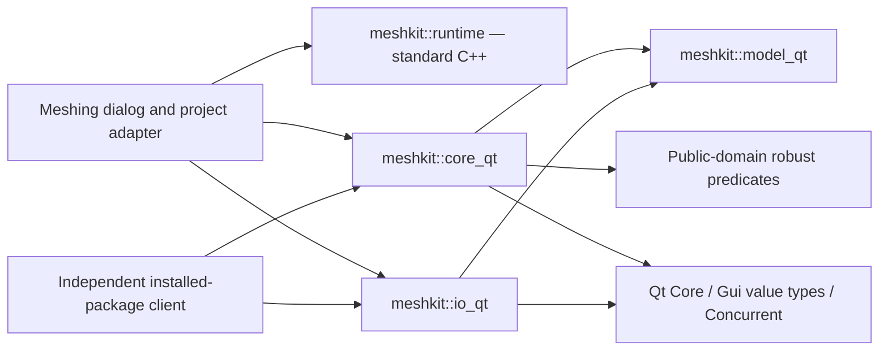
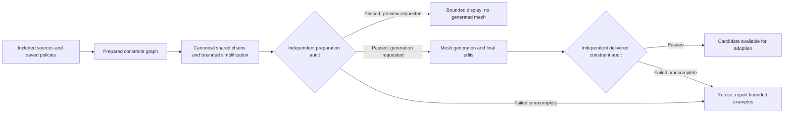

# Meshing implementation — first delivery

Date: 2026-10-29. Based on the [review and implementation plan](2026-10-29-meshing-review-and-library-extraction-plan.md). This records the implemented foundation and its remaining limits; the full numerical-policy redesign is not complete.

## Implemented

- A persistent **Run log** tab in the meshing dialog, including severity/search filtering, details, copy, text/JSONL export, follow-latest, retained completion/cancellation/failure reports, and exception highlighting.
- Per-job structured events with distinct working-vertex, output-vertex, triangle, quad, insertion and removal counts; monotonic overall progress; explicit second-pass labels; throttled GUI updates; bounded producer queue (2,048 rows by default) and visible history (10,000 rows). Overflow counts are visible and exported. No global Qt logging handler is installed.
- Live triangle counts maintained at topology edits, avoiding scans at every progress update. Tests compare the maintained count against scanned liveness after refinement, boundary splitting and coarsening.
- Resource-limited results reported as incomplete and refused by GUI adoption, preserving the prior mesh. Successful generation retains the dialog for review; closing it still returns the accepted result expected by the application.
- Exception membership stored in one bit per cell, with exact total counts and at most 10,000 selected examples. This avoids millions of hash-table/selection objects.
- A standalone [MeshKit CMake project](../../libraries/meshkit/README.md), linked by the GUI and tests. It contains the existing constrained mesher, size field, patch/strip/quad helpers, mesh statistics/reordering, interpolation, and native INP/2DM plus SMS readers/writers. Core algorithm tests now live with the library. Installed targets work in a separate downstream client.
- A global triangles-only gate covering generated quad regions, conduit strips and terrain strips. It preserves region boundaries/tags/local sizes and explicitly rejects contradictory prebuilt quad patches. Default standalone behavior remains unchanged.
- A [file provenance inventory](../../libraries/meshkit/PROVENANCE.md) covering 51 tracked predecessors, preserving the GPL and public-domain predicate notices. No permissive relicensing has been performed.

## Extraction boundary

The geometry and codec targets retain their current Qt value/container API, named `_qt` deliberately. They build without OpenSWMM, its engine, Widgets or GDAL. Only the event runtime is currently Qt-free. Terrain/GIS providers, boundary conditioning, GUI worker orchestration, project adoption/undo and feature export remain application adapters. Shared infiltration metadata and some serialization helpers remain in `model_qt`.

Moving these implementations first makes their tests and downstream linkage independently reproducible. The planned neutral array API, Qt adapter, standalone orchestration and streaming codecs are still needed before the final independent-release gate. Existing codec validation/precision limitations remain. A standalone legacy caller must check `stats().refineCapped`, not only `MeshResult::ok`.

## Validation evidence

Baseline before implementation: CDT 22 passed; generator 20 passed. Current checks:

- Application and selected test targets build successfully. The local macOS deployment step reports missing optional SQL driver dependencies, then excludes those unused drivers and finishes successfully.
- [Standalone CTest](../../tests/output/meshing_library_2026-10-29/standalone-test.log): 4/4 suites passed, including the CDT/generator suites, event stress and mesher/codec roundtrip.
- [GUI-linked regressions](../../tests/output/meshing_library_2026-10-29/regression-tests.log): 11/11 suites passed, covering CDT, generator, log model, native/SMS codecs, constraint preparation/trimming, size field, reorder and cell parameters.
- [Full terrain worker suite](../../tests/output/meshing_library_2026-10-29/pipeline-full.txt): 75 passed, no failures; 3 opt-in large/project benchmarks skipped. [Targeted outcome/adoption run](../../tests/output/meshing_library_2026-10-29/pipeline.txt): 25 passed, including resource-limit refusal and accepted closure after successful adoption.
- [Infiltration integration](../../tests/output/meshing_library_2026-10-29/infiltration-tests.log): passed.
- [Runtime-only build](../../tests/output/meshing_library_2026-10-29/runtime-only-test.log): passed with Qt explicitly disabled.
- Installed-package consumer configures, links and generates/serializes a mesh with only the installed MeshKit package and Qt in its dependency paths.
- The 600-hole/24-breakline reference fixture retains 19,249 cells and its pre-extraction hash `665bcd25f66fd6bd`.
- Modified tracked source/document files pass whitespace checks. Existing unrelated example-file whitespace issues were left untouched.

The log widget screenshot uses synthetic demonstration events, not the large mesh benchmark: [Run log preview](../../tests/output/meshing_library_2026-10-29/run-log.png).

| Kernel workload | Input vertices | Live triangular cells | Elapsed, including checks | Peak process RSS |
| --- | ---: | ---: | ---: | ---: |
| Uniform grid, four constrained sides | 50,451 | 100,000 | 0.073 s | 21.9 MB |
| Six-million-cell probe | 3,003,501 | 6,000,000 | 19.678 s | 413.5 MB |
| Six-million-vertex probe | 6,000,000 | 11,990,002 | 31.540 s | 766.1 MB |

Release build; Qt 6.9.3; Apple arm64/macOS 27.0.1; timings from this local run while other compilation work was active. MB are decimal. These probes verify the expected live count, positive triangle areas and total rectangular area. They are **kernel capacity measurements**, not end-to-end DEM, mixed-cell, file I/O, GUI/renderer, cancellation or hydraulic performance certification. Six million vertices and six million cells are distinct workloads.

Reproduce with `MESHKIT_BUILD_BENCHMARKS=ON`, then `meshkit_scale_probe 2001 1501` and `meshkit_scale_probe 3000 2000`. Raw reports: [six million cells](../../tests/output/meshing_library_2026-10-29/scale-6m-cells.json), [six million vertices](../../tests/output/meshing_library_2026-10-29/scale-6m-vertices.json). The six-million-event stress test separately verifies bounded logging; it does not stand in for a mesh benchmark.

## Synthetic terrain worker at scale

The complete headless GUI worker was also exercised on a 24,039,409-sample planar DEM, using a 16 MiB terrain cache and the actual meshing/refinement, optional open-block second pass, elevations, reordering and final terrain verification stages.

| Cell mode | Delivered cells | Quads | Elapsed | Peak process RSS |
| --- | ---: | ---: | ---: | ---: |
| Triangles only | 6,499,882 | 0 | 16.924 s | 2.450 GB |
| Automatic mixed | 3,345,190 | 2,450,508 | 27.076 s | 2.962 GB |

Both runs passed, with zero unresolved/unknown terrain cells and no refinement cap. The triangular run exceeds six million delivered cells. The mixed run uses the same resolution recipe but yields fewer cells; it is not evidence of six million mixed cells. These measurements include worker-owned mesh/terrain data, but not GUI rendering, an existing GUI mesh, undo history or final mesh-file publication. They do not certify difficult terrain, hydraulic equivalence or worst-case geometry.

The first mixed run completed correctly but failed the old benchmark's `cells > 0.85 × target` assertion: that target was calibrated for triangles. The benchmark now makes cell mode explicit (`SWMMVIS_TERRAIN_SCALE_QUADS=0`, or `2` for mixed) and applies that count assertion only to its calibrated triangular workload. The original failed assertion is retained in [the original mixed-run transcript](../../tests/output/meshing_library_2026-10-29/terrain-mixed-original-assertion.txt); production sizing was not changed to satisfy the benchmark.

Reproduce the triangular case with `SWMMVIS_TERRAIN_SCALE_CELLS=6000000`, `SWMMVIS_TERRAIN_SCALE_QUADS=0`, a writable `SWMMVIS_TERRAIN_PIPELINE_OUTPUT`, and the normal test GDAL/PROJ paths, then run `test_meshterrainpipeline largeTerrainPipelineBenchmark`. Evidence: [triangular run](../../tests/output/meshing_library_2026-10-29/terrain-6m-triangles.txt), [mixed run](../../tests/output/meshing_library_2026-10-29/terrain-mixed.txt), [machine-readable results](../../tests/output/meshing_library_2026-10-29/terrain-scale-results.json).

## Remaining work against the plan

| Area | Current state | Next deliverable |
| --- | --- | --- |
| Baseline/reporting | Core/log/adoption tests, kernel capacity and synthetic-plane worker measured; broader workload and rights review incomplete | Realistic terrain, holes, mixed-cell, I/O and GUI baselines with memory/cancellation evidence |
| Independent library | Build/install/downstream linkage implemented with transitional Qt types | Qt-free geometry/arrays, standalone request/report orchestration, terrain and streaming format adapters |
| Constraint simplification | Bounded collection pass, exact-coordinate joining and per-feature line overrides implemented in the second delivery | Canonical shared edges; source-level policy UI; preview; independent delivered-geometry audit |
| Sizes and transitions | Existing target calibration retained and reported | Versioned nominal-size metrics, feasibility checks, conservative footprint caps, independent audit and bounded local repair |
| Quad policy | Triangles-only inconsistency fixed; current mixed planner retained | Unified local precedence and mandatory/preferred regions; single-pass planning; bounded recombination |
| Terrain thinning/coarsening | Existing certified transactional removals retained | Optional target-size-weighted tolerance used consistently in refinement, removal and final checks; small-terrain exhaustive comparisons |
| Licensing/Python | Notices retained and provenance inventoried; no new licensing or bindings | Resolve rights and license; array-oriented Python API, ownership/GIL/cancellation and packaging tests |

No new simplification, size-floor, maximum-size, transition or terrain-weighting guarantee is claimed by this delivery. The 1.22 target calibration and current geometry-conditioning behavior remain in the legacy algorithm. Those numerical changes require the versioned policy and independent checks described in the plan.

## Second delivery — docked navigation and constraint policies

The Quality category list now lives in an embedded main-window dock. It starts on the left, can move to the right or float, and reserves enough width for its longest label plus scrollbar/frame at the current font. The layout test verifies 12/24-point labels, category selection while floating, redocking to the opposite side, and a genuinely embedded host. The [enlarged-font preview](../../tests/output/meshing_policies_2026-10-29/quality-docked.png) was visually checked.

A new collection-level `constraintsimplifier` in MeshKit implements per-feature preserve/simplify policies, XY and authored-Z limits, corner/fixed-point protection, absolute/relative ring-area bounds and optional minimum clearance. One immutable segment BVH supports shortcut/obstacle checks. Every shortcut checks its entire original span and monotone projection; original vertices lie within the replacement segment's convex tolerance capsule and the continuous span covers its projected interval, supplying a bidirectional XY bound. Swept-pocket tests protect holes and constraint components that could otherwise be excluded without an edge crossing. An output index checks new shortcuts against each other. Conflicts roll back; bounded work and cancellation retain original geometry. Stable source-vertex mappings and per-feature statistics are returned.

The dialog offers the existing recipe, preserve, and bounded modes. Existing recipes retain their behavior. New modes skip footprint generalization and proximity welding, preserve exact existing coordinates during joining, reject invalid protected holes, and refuse mixed inside/outside source paths rather than deleting outside intermediate vertices. Authored conduit unfolding/resampling is disabled in these modes; curved strips use plain constraints when their patch construction could approximate the path. Region/patch outlines and mandatory points remain protected. Auxiliary lines accept `mesh_simplify`, `mesh_xy_tol` and `mesh_z_tol` feature overrides. New geometry preparation bypasses the legacy boundary cache to prevent cross-policy cache reuse.

Standalone tests cover semantic pins, shared edges, nearby constraints, elevation detail, ring-area rollback, swept-pocket hole protection, cancellation, work budgets and source mappings. A six-million-vertex straight-source probe retained two endpoints in 1.221 seconds at 376,356,864 bytes process peak RSS. This is a simplifier capacity check, not evidence for complex six-million-edge arrangements or rendering. The generator additionally verifies that a narrow hole survives exact-coordinate joining.

This advances phase 3; canonical shared-edge editing, source-level policy UI beyond feature attributes, interactive before/after preview and a complete delivered-mesh policy audit remain. Revised sizing/transitions and resolution-weighted thinning remain later numerical phases. GPL terms and the transitional Qt API are unchanged.

Validation-build note: a concurrent application build was using `build/` with a different CMake executable. This task moved compilation to ignored `build-mesh-policies/` to avoid interleaved manifests. Its compiler-cache access is read-only, with temporary files in the task's writable cache directory. No other task's build process was stopped. The isolated application build completed successfully. The full integrated terrain suite passed 76 cases with no failures and three opt-in workloads skipped. The dock layout test passed all three cases, and all five standalone MeshKit suites plus the installed-package consumer passed. The new pipeline case exercises bounded/preserve modes, line-level overrides, hole retention and refusal of outside intermediate vertices. It caught and fixed an existing missing-closure bug for programmatic hole rings: the generator adapter now explicitly closes every hole constraint loop before adding the carve seed. Existing explicitly closed GIS rings are unaffected. See [pipeline results](../../tests/output/meshing_policies_2026-10-29/pipeline-full.txt) and [dock results](../../tests/output/meshing_policies_2026-10-29/dock-test.txt).

## Quality column correction and unrestricted transition input

The navigation dock's viewport could widen while the hidden tree header kept the text column at 100 pixels. The column now stretches to the viewport, with elision disabled and the existing label/font-aware minimum width retained. The regression checks the **actual text-column width** before any font changes, after resizing the dock and dialog, and at 12/24-point fonts. Docking/floating and page-selection checks remain. The prior viewport-only check missed this defect.

The transition input and shared settings validation now accept every finite rate at least 1.05, including values above 10. The default remains 2. The size-field's float storage and chamfer weights saturate at its existing finite sentinel so extreme accepted rates do not overflow the stored grid. This removes an authoring restriction; it does not add a guarantee on delivered adjacent-cell ratios.

The focused checks pass: 4 dock/settings cases and 14 size-field cases, including rates 25, 1000, 1e12 and the largest finite double, JSON settings roundtrip, invalid-value rejection, the effect of a larger transition rate, and finite bounded size-field samples. See [dock/settings results](../../tests/output/mesh-width-transition-2026-10-29/dock-tests.txt), [size-field results](../../tests/output/mesh-width-transition-2026-10-29/sizefield-tests.txt) and the [column preview](../../tests/output/mesh-width-transition-2026-10-29/quality-docked.png). Native macOS verification is complete: the focused dock/settings suite passes all 4 cases on Cocoa as well as offscreen. The full mesh-dialog suite passes all 6 cases, including typing 25 and verifying the actual text column at 900/1200-pixel dialog widths. The [native dialog capture](../../tests/output/mesh-width-transition-2026-10-29/quality-dialog-native.png), [wider capture](../../tests/output/mesh-width-transition-2026-10-29/quality-dialog-native-wide.png), [native dock results](../../tests/output/mesh-width-transition-2026-10-29/dock-native-tests.txt) and [integrated dialog results](../../tests/output/mesh-width-transition-2026-10-29/dialog-native-tests.txt) record this.

Local test-copy build note: application compilation completed, but a fresh macOS dependency deployment spent more than 17 minutes scanning unchanged Qt libraries. Only this task's packaging process was interrupted. The generated application link command was rerun against the freshly compiled objects; its linked-library list exactly matches the previously deployed app. The test copy reuses that package, with the new executable and the same relative library search path, and passes deep strict code-signature verification. It is at `build-mesh-policies/width-preview-ready/SWMMVis.app`, with the local-only display name **SWMMVis Mesh Preview** and a distinct bundle identity. The original GUI process was left running. This is a local test package, not a completed fresh-dependency deployment or release-package certification.

The integrated native dialog test was linked against those same application objects, replacing only the application entry point with its QtTest entry point and adding QtTest. It logs a missing standalone-harness OpenSWMM QML registration warning; the check covers the dialog and input behavior, not map rendering. Native widget grabs provide the layout evidence because the desktop controller could not reliably resolve multiple locally renamed app copies. No mesh generation or project save was requested by these UI checks.

## Source controls, shared constraints and independent audits — delivered increment

A newly requested regression reproduced the coarsening checkbox failure: a domain-covering triangle-only region was still included in the protected quad-region index. The checkbox reached the worker, but that protection left zero eligible attempts. `MeshGenerator` now protects only regions actually resolved as mapped quad patches. The checkbox-to-worker on/off regression passes with adaptive terrain both off and on, and the standalone generator suite passes, including pin/constraint/mapped-quad preservation. Evidence: `tests/output/constraint-review-2026-10-29/coarsening-before.txt` and `coarsening-after.txt`. Worker reporting now distinguishes skipped coarsening, no eligible free vertices and all attempted edits being rejected. The rebuilt local test copy at `build-mesh-policies/constraint-preview-ready/SWMMVis.app` includes this correction. In the checkbox-to-worker fixture, both terrain-off and terrain-on runs change from 287 cells with removal disabled to 283 with it enabled: 112 attempts and two removed vertices in each case. An enabled option can still legitimately remove nothing when all candidates are protected or fail size, shape or terrain checks.

The constraint increment now includes an exact shared-chain adapter and independent geometry audits. Exact shared original segments are grouped into chains, simplified once under the strictest owner limits, then stitched back with source-index mappings. Ring-area rejection rolls back the connected shared component. Different source sampling remains conservative. Work/memory exhaustion retains originals. Independent checks cover retained identities, XY/Z/area/corner bounds, shared consistency, original junctions, pockets/clearance, and delivered constraint coverage against actual incident cell edges (including domain/hole sides). The delivery checker is a constraint audit, not a general certificate that arbitrary cells never overlap.

The dialog now includes **Quality → Boundaries → Source-specific limits** for boundary sources, auxiliary line layers and model conduits. Optional source limits inherit the global values; feature attributes override source settings. Saved source policies use physical units, preserve their exact values across display-unit changes, retain unavailable source entries and refuse invalid saved limits until explicitly corrected. Conduits preserve by default. Multi-vertex conduit paths in the new modes remain ordinary constrained lines, since strip resampling could discard their authored vertices.

**Preview constraints…** runs preparation and its independent audit, then returns before terrain opening or mesh generation/adoption. The preview overlays prepared originals, proposals and sampled removal markers, with source counts/deviations and stale-input indication. Display data is capped at 50,000 vertices (including markers) and 500 features; the audit uses the full geometry. Selected polygon sources may already have been dissolved during preparation. The preview therefore compares prepared constraints, not original undissolved GIS features. Normal generation also retains this preview and must pass the delivered constraint audit after all geometry/elevation edits and reordering.

Validation for this increment:

- All five standalone library suites pass, including exact zero-deviation collinear cleanup, reversed shared rings/strict owner limits, conflicting shared Z, lost-junction/pocket protection, resource/cancellation behavior, tampered-audit rejection, actual cell-edge incidence and hole-side checks. A projected-coordinate generator case retains distinct vertices only 0.0001 units apart at coordinates near 1e9, with delivered coverage audited. This also caught and corrected an audit false rejection from counting a neighbouring edge that only touched a source segment endpoint.
- The full integrated terrain/pipeline suite passes **80 cases, zero failures, three optional workloads skipped**. It exercises source and feature override precedence, preparation-only early return, invalid metadata/missing boundary refusal, both audits, preview no-adoption/no-save behavior, source-policy persistence and checkbox-driven coarsening. Existing legacy generation, corridor adoption/ownership and saved-file protections still pass.
- Native macOS source/preview widget checks pass all five cases; the native full mesh-dialog suite passes all six. Normal/wide captures show the Quality column filling its dock and the source controls fitting the available width with vertical scrolling. The preview display is bounded without altering geometry. The standalone full-app test entry point still logs missing OpenSWMM QML registration; these tests certify dialog/worker behavior rather than map rendering.
- Straight-source preparation and independent audit at **6,000,000 vertices** complete in **4.422 s**, with **719.2 MB peak RSS** (simplification alone 2.567 s). A reversed shared source pair totalling **6,000,000 owner vertices** completes in **7.819 s**, **809.4 MB peak RSS** (simplification alone 4.188 s). These are simple capacity probes, not complex terrain/constraint guarantees. Temporary workspace limits are estimates and do not bound total process memory.

Evidence is under `tests/output/constraint-review-2026-10-29/`: `core-ctest.txt`, `pipeline-full.txt`, `pipeline-focused.txt`, `widget-tests-native.txt`, `dialog-native.txt`, `six-million-constraints.txt`, `six-million-shared.txt`, `constraint-preview-cocoa.png`, and `boundary-dialog-native.png` / `boundary-dialog-native-wide.png`.

The delivered-audit scale probe also passes at **6,000,000 cells** / 3,003,501 vertices. Converting the CDT to the current GUI DTO takes 0.286 s; the independent constraint audit takes **0.970 s**, scans every cell's incidence and checks the four required sides. Total triangulation, conversion and audit time is 16.860 s, at **1.047 GB peak RSS** with both geometry representations resident. See `six-million-cells-audit.json`. This is a uniform constrained grid capacity result, separate from the existing terrain-worker benchmarks and from GUI rendering. It is opt-in via `MESHKIT_AUDIT_DELIVERED=1 meshkit_scale_probe 2001 1501`.

The local application was linked from freshly compiled production objects. Its dependency list matches the preceding deployed preview; the test package reuses those deployed libraries and passes deep strict code-signature verification. This remains a local test package rather than a fresh-dependency release certification. It uses the distinct bundle identity `org.openswmm.swmmvis.constraint-preview` and was opened for testing. Existing user GUI sessions were left running. All new work stays in the existing checkout; no subagents or unrelated build processes were used.

Next in the original plan: independent delivered minimum/maximum/transition diagnostics and explicit exception attribution, then unified local/global tri/quad policy and resolution-aware thinning. The final Qt-free geometry/I/O interfaces, streaming output, Python bindings and permissive-license ownership/dependency decision remain outstanding. This increment does not mark the entire meshing redesign complete.
